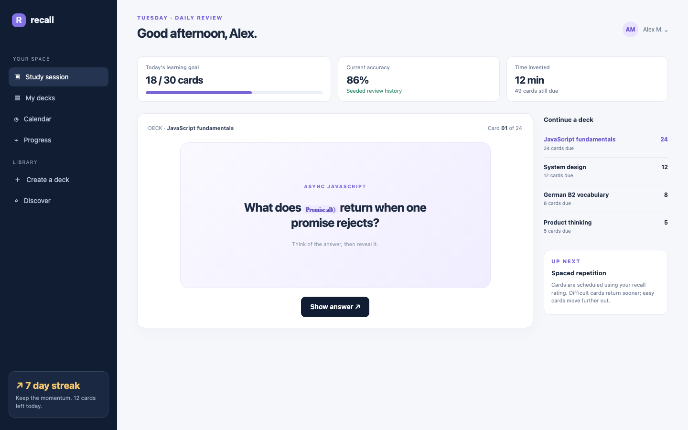

# Flashcards

A focused spaced-repetition study space: four decks with 49 due cards, one card at a time, reveal and four recall ratings, an SM-2-like scheduler, deck and card creation, a review calendar and a progress history.

## Run it

`npm install && npm start`; `npm test` runs the suite with no port or credentials. Tests pin TZ=UTC and pass under America/Los_Angeles and Asia/Tokyo.

## What is here

- **Study session** (`/`): the daily goal, accuracy and time, the due card, reveal, Again/Hard/Good/Easy ratings and the per-deck due counts.
- **Decks** (`/decks`, `/decks/new`, `/decks/:id`): the deck list, create form and the card list with add-card.
- **Calendar** (`/calendar`): upcoming reviews by date.
- **Progress** (`/progress`): goal, accuracy, streak and the recent review history.

Each screen is its own Cordis plugin with a `plugin.json` and a `blend.yaml` row; Settings > Plugins switches any off.

## Design notes

The seed is the mockup's JavaScript deck and first Promise card, plus three more decks with 24/12/8/5 due cards and 18 reviews today; the accuracy is computed over the full review history. The scheduler is a pure SM-2-like policy behind the service; ratings are stored with the interval before and after.

## What to ask the chat next

- Reveal the Promise card and rate it Easy; show the next due date.
- Create a deck and add its first card.
- Open Progress and explain the difference between today's goal and the all-time accuracy.

## Screenshot

